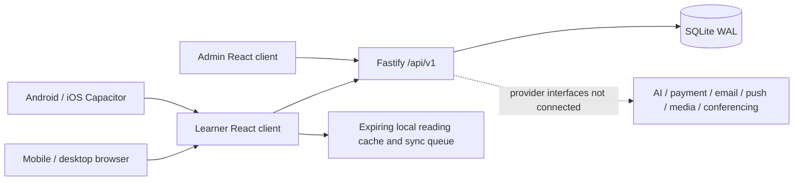

# Prototype architecture

## Product boundaries

- `Qubit-lms-proto-app`: learner React/TypeScript client, Vite, Capacitor iOS/Android, offline web shell.
- `Qubit-lms-proto-cp`: independent React/TypeScript administration client plus shared Fastify API and SQLite persistence.
- Two frontends share API contracts and visual conventions; neither imports source from its sibling checkout. They can be built independently. Running learner workflows requires the API.

## Choices and practical limits

A modular monolith is appropriate for a reviewable prototype. Fastify validates authentication, roles, tenant ownership and allowed mutation fields at the API boundary. SQLite makes the environment reproducible without service credentials. It is not the PRD's proposed production PostgreSQL platform. A general `records` store holds prototype domain documents; users, sessions, progress, deduplication events, enrolments, attempts and personal records have dedicated constraints. Production should replace prototype documents with normalised relational models and migrations.

The application uses synchronous SQLite operations and a single API process. Do not use this configuration to claim scalability, SLO compliance or load-test readiness. Uploads are bounded to 5 MB and stored within the prototype database. There is no object storage, media pipeline, malware scanner or running delivery worker.

## Correctness boundaries

- Passwords are salted/scrypt hashed; only session-token hashes are persisted. HttpOnly cookies have an explicit lifetime. Separate learner/admin cookie names allow side-by-side review.
- Mutation requests require a surface header; allowed browser origins are explicit. Cross-origin writes are rejected. Cookies are SameSite Lax in local browser development. Native cross-site/HTTPS session policy still needs implementation and device testing.
- API route permission maps distinguish platform administrators, tenant administrators, instructors, support, finance and learners. Resource lookups enforce tenant scope. Learners only read their own progress, work and personal records.
- Published course versions snapshot metadata and lessons. New drafts cannot mutate an existing learner's lesson content. Enrolled learners retain their old version while a new draft is prepared. There is no learner migration UI or production rollback engine.
- Progress writes carry unique per-user event keys. A SQLite transaction deduplicates the event and updates the progress record. Completion is monotonic. The position uses the maximum acknowledged value; backward seek/resume semantics should be designed for a real media player.
- Assessment attempts snapshot questions/answers on the server. Learner responses never receive answer keys until submission. Time limit and attempt cap are checked at the server. Submitted scores cannot be replaced by a client-provided value. Objective scoring supports the seeded single, multiple, true/false and exact text questions.
- Certificates require all required lessons in the enrolled snapshot plus a submitted passing assessment. Issuance is idempotent; revocation and API verification work.
- Audit events have no mutation/delete endpoint. They are not tamper-evident against a database administrator. Production needs a separately controlled audit destination.
- Local backups use SQLite's online backup API and verify integrity/readability. This is not an encrypted offsite backup or disaster recovery guarantee.

## API map

All paths are prefixed `/api/v1`; successful operations return the resource or workflow result. Errors use `{error:{code,message,request_id,retryable}}`. `server/app.mjs` is the executable contract; a generated OpenAPI specification remains production work.

| Area | Routes |
| --- | --- |
| Identity | POST `/auth/login`, `/auth/register`, `/auth/logout`, `/auth/password-reset`; GET/PATCH `/me`; POST `/me/password`; GET/DELETE `/me/sessions[/:id]` |
| Catalogue | GET `/catalog/courses`, `/courses/:id`; POST `/courses/:id/enrolments` |
| Learning | GET `/lessons/:id`, `/me/learning`; PUT `/lessons/:id/progress`; PUT/DELETE `/me/:kind/:id` for notes, bookmarks, saved courses and read receipts |
| Assessment | POST `/quizzes/:courseId/attempts`; PUT `/quiz-attempts/:id/responses`; POST `/quiz-attempts/:id/submit` |
| Work & files | POST `/assignments/:id/submit`, `/uploads`; GET `/uploads/:id` |
| Communications | GET `/learning/resources/:kind`; POST `/support`, `/discussions/:id/replies` |
| Privacy | GET `/me/export`; POST `/me/privacy` |
| Certificates | POST `/courses/:id/certificate`; GET `/certificates/:id/verify` |
| Reference companion | POST `/tutor` with authorised lesson, question and requested mode |
| Administration | GET `/admin/dashboard`, `/admin/users`, `/admin/roles`, `/admin/audit`; POST/PATCH `/admin/users[/:id]`; POST `/admin/users/:id/revoke`, `/admin/enrolments` |
| Publishing | GET/POST `/admin/courses`; PATCH `/admin/courses/:id`; GET/POST `/admin/courses/:id/lessons`; PATCH `/admin/lessons/:id`; POST `/admin/courses/:id/preflight`, `/publish`, `/new-version` |
| Configurable domains | GET/POST `/admin/resources/:kind`; PATCH `/admin/resources/:kind/:id`; server allowlists restrict each domain's fields and permissions |
| Operations | GET `/health`; POST `/admin/jobs/:id/retry`, `/admin/export/:kind`; GET/PATCH `/admin/settings` |

Admin tables sort, search and paginate client-side over bounded prototype data. Server-side pagination, ETags for all domains, generated contracts and cursor-based exports remain production work. Only course edit revision conflict detection is implemented.
